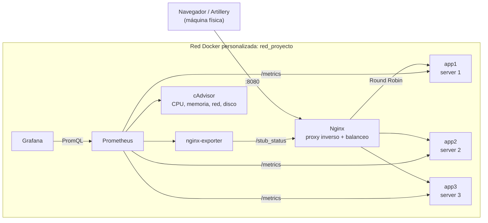

# Proyecto final – Sistemas Operativos (UAO)

Infraestructura en contenedores Docker: **Nginx** como proxy inverso y balanceador de carga
delante de **3 backends** Flask, con monitoreo de **Prometheus**, **Grafana**,
**nginx-prometheus-exporter** y **cAdvisor**, y pruebas de carga con **Artillery**.

**Integrantes:** Sara Martínez Arboleda, Santiago Cuenú Alomia y Gabriela Ortega Medina

---

## Arquitectura



| Servicio | Imagen | Puerto en el host | Función |
|---|---|---|---|
| `app1`, `app2`, `app3` | construida con `backend/Dockerfile` (Python 3.12.14) | — (no expuestos) | Backend Flask + Gunicorn; `/`, `/health`, `/metrics`, `/slow` |
| `nginx` | `nginx:1.27.5-alpine` | **8080** | Proxy inverso, balanceo Round Robin y `/stub_status` |
| `nginx-exporter` | `nginx/nginx-prometheus-exporter:1.5.3` | 9113 | Traduce `/stub_status` a métricas de Prometheus |
| `cadvisor` | `ghcr.io/google/cadvisor:v0.60.6` | 8081 | Uso de recursos de cada contenedor |
| `prometheus` | `prom/prometheus:v3.15.1` | **9090** | Recolecta y guarda las métricas (cada 5 s) |
| `grafana` | `grafana/grafana:13.2.4` | **3000** | Dashboards |

- Todos los servicios están en la red personalizada `red_proyecto` y se encuentran por nombre.
- Los backends **no publican puertos**: solo se llega a ellos a través de Nginx.
- Los datos de Prometheus y Grafana se guardan en volúmenes con nombre
  (`prometheus_data`, `grafana_data`).

## Estructura del repositorio

```
backend/         app.py, requirements.txt, Dockerfile, .dockerignore
nginx/           nginx.conf (proxy inverso, balanceo y stub_status)
prometheus/      prometheus.yml (targets a monitorear)
grafana/         provisioning/datasources/prometheus.yml (conexión a Prometheus)
loadtest/        escenarios de Artillery
docs/            apuntes de cada fase, resultados de las pruebas de carga
docker-compose.yml
```

---

## Requisitos previos

- **Docker** y **Docker Compose v2**. En Windows: Docker Desktop con WSL2 y la integración
  activada para la distro (*Settings → Resources → WSL Integration*).
  ```bash
  docker --version            # probado con 29.9.2
  docker compose version      # probado con v5.6.1
  ```
- **Puertos libres** en el host: 8080, 8081, 3000, 9090 y 9113.
- Solo para las pruebas de carga: **Node.js ≥ 22.18** y **Artillery 2.0.34**.
  En Ubuntu/WSL:
  ```bash
  sudo apt update && sudo apt install -y nodejs npm
  sudo npm install -g artillery@2.0.34
  ```

## Levantar la infraestructura

Desde la raíz del repositorio:

```bash
docker compose up -d --build
```

La primera vez tarda unos minutos (descarga las imágenes y construye el backend). Nginx espera a
que los 3 backends estén `healthy` antes de arrancar. Comprobar el estado:

```bash
docker compose ps
```
```text
NAME                              STATUS                    PORTS
proyecto-final-app1-1             Up 21 seconds (healthy)   5000/tcp
proyecto-final-app2-1             Up 20 seconds (healthy)   5000/tcp
proyecto-final-app3-1             Up 21 seconds (healthy)   5000/tcp
proyecto-final-cadvisor-1         Up 21 seconds (healthy)   0.0.0.0:8081->8080/tcp
proyecto-final-grafana-1          Up 17 seconds             0.0.0.0:3000->3000/tcp
proyecto-final-nginx-1            Up 17 seconds             0.0.0.0:8080->80/tcp
proyecto-final-nginx-exporter-1   Up 17 seconds             0.0.0.0:9113->9113/tcp
proyecto-final-prometheus-1       Up 17 seconds             0.0.0.0:9090->9090/tcp
```

## URLs de acceso (desde el navegador del host)

| Qué | URL | Notas |
|---|---|---|
| **Aplicación (Nginx)** | http://localhost:8080 | Recargar (F5) alterna entre server 1, 2 y 3 |
| Estado de Nginx | http://localhost:8080/stub_status | Conexiones y peticiones totales |
| **Prometheus** | http://localhost:9090 | Estado de los targets: http://localhost:9090/targets |
| **Grafana** | http://localhost:3000 | Usuario `admin`, contraseña `admin` (pide cambiarla la primera vez). La fuente de datos Prometheus ya viene configurada |
| cAdvisor | http://localhost:8081 | Contenedores: http://localhost:8081/containers/ |
| nginx-exporter | http://localhost:9113/metrics | Métricas `nginx_*` |

> En el navegador, el reparto puede no verse perfecto: el navegador también pide `/favicon.ico`
> y eso consume turnos del Round Robin. Las pruebas con `curl` de abajo son exactas.

## Verificar el balanceo de carga

**1. Reparto de 12 peticiones** (debe salir 4 / 4 / 4):

```bash
for i in $(seq 1 12); do curl -s localhost:8080 | grep -o "server [0-9]"; done | sort | uniq -c
```
```text
      4 server 1
      4 server 2
      4 server 3
```

En Windows PowerShell:
```powershell
1..12 | ForEach-Object { curl.exe -s http://localhost:8080 | Select-String "server \d" } | ForEach-Object { $_.Matches.Value } | Group-Object | Select-Object Count, Name
```

**2. Quién atendió cada petición:** `X-Backend` lo pone Flask y `X-Upstream` lo pone Nginx.
```bash
curl -sI localhost:8080 | grep -E "X-Backend|X-Upstream"
```
```text
X-Backend: server 2
X-Upstream: 172.18.0.5:5000
```

**3. Los backends no son accesibles directamente** (debe fallar):
```bash
curl -sS -m 3 localhost:5000
# curl: (7) Failed to connect to localhost port 5000 ... Could not connect to server
```

**4. Tolerancia a fallos:** apagar un backend y comprobar que todas las peticiones siguen
respondiendo 200 (la primera puede tardar ~2 s mientras Nginx detecta la caída):
```bash
docker compose stop app1
for i in $(seq 1 10); do curl -s -o /dev/null -w "%{http_code} %{time_total}s\n" localhost:8080; done
docker compose start app1
```

**5. Registro de Nginx:** cada línea muestra a qué backend fue la petición.
```bash
docker compose logs --tail 12 nginx
```

## Verificar el monitoreo

- **Prometheus → Status → Targets** (http://localhost:9090/targets): los 5 targets deben estar
  en **UP**: `app1:5000`, `app2:5000`, `app3:5000` (job `backends`), `nginx-exporter:9113`
  (job `nginx`) y `cadvisor:8080` (job `cadvisor`).
- Consultas de ejemplo en Prometheus (pestaña *Query*):
  ```promql
  sum by (servidor) (rate(http_requests_total[1m]))       # peticiones por segundo por backend
  histogram_quantile(0.95, sum by (le, servidor) (rate(http_request_duration_seconds_bucket[1m])))   # latencia p95 (s)
  ```
- Las consultas de los paneles de Grafana están en [`docs/fase5-grafana.md`](docs/fase5-grafana.md).

## Ejecutar las pruebas de carga

Se ejecutan **desde el host** (no desde un contenedor) contra `http://localhost:8080`:

```bash
export ARTILLERY_DISABLE_TELEMETRY=true      # opcional: no enviar estadísticas de uso de Artillery

artillery run loadtest/carga-70-por-minuto.yml          # ~70 peticiones por minuto a /
artillery run loadtest/carga-100-por-segundo.yml        # 100 por segundo a / durante 60 s
artillery run loadtest/carga-120-por-segundo.yml        # 120 por segundo a / durante 60 s
artillery run loadtest/saturacion-100-por-segundo.yml   # 100/s a /slow?ms=500 (satura el sistema)
artillery run loadtest/saturacion-120-por-segundo.yml   # 120/s a /slow?ms=500
```

Para guardar el resultado: `artillery run --output resultado.json loadtest/<archivo>.yml`.

Mientras corre una prueba, en otras terminales se puede observar:
```bash
docker compose logs -f nginx      # cada petición y a qué backend fue
docker stats                      # CPU y memoria en vivo
```

Resultados obtenidos (detalle y análisis en [`docs/fase6-carga.md`](docs/fase6-carga.md)):

| Prueba | Respuestas 200 | p95 |
|---|---|---|
| 70 por minuto (`/`) | 70 / 70 | 2 ms |
| 100/s (`/`) | 6.000 / 6.000 | 3 ms |
| 120/s (`/`) | 7.200 / 7.200 | 3 ms |
| 100/s (`/slow` 500 ms) | 889 / 6.000 | 9,6 s |
| 120/s (`/slow` 500 ms) | 770 / 7.200 | 9,4 s |

Con `/slow?ms=500` la capacidad teórica es 3 backends × 8 hilos ÷ 0,5 s = **48 peticiones/s**;
por encima de eso las peticiones hacen cola y superan el timeout de 10 s.

## Detener la infraestructura

```bash
docker compose down        # detiene y elimina los contenedores; CONSERVA los datos
```

> ⚠️ **No usar `docker compose down -v`**: la `-v` borra los volúmenes `prometheus_data` y
> `grafana_data`, es decir, todo el historial de métricas y **los dashboards de Grafana**.

---

## Solución de problemas

| Problema | Causa y solución |
|---|---|
| `docker: command not found` en WSL | Activar la integración de Docker Desktop con la distro (*Settings → Resources → WSL Integration*) |
| "port is already allocated" | Otro programa usa el puerto. Cerrarlo o cambiar el puerto del host en `docker-compose.yml` |
| Después de reconstruir los backends, Nginx da 502 o no reparte | Nginx resuelve las IP de `app1..3` solo al arrancar. Ejecutar `docker compose restart nginx` |
| Cambié `nginx.conf` y no pasa nada | Validar y recargar: `docker compose exec nginx nginx -t` y luego `docker compose exec nginx nginx -s reload` |
| Nginx no arranca tras editar `nginx.conf` | Revisar `docker compose logs nginx` (error de sintaxis) |
| Grafana no muestra datos | La fuente de datos debe ser `http://prometheus:9090` (no `localhost`); ya viene configurada. Revisar el rango de tiempo arriba a la derecha |
| Durante una prueba de saturación los backends aparecen `unhealthy` | Es esperado: `/health` hace cola detrás de las peticiones lentas. Se recuperan solos al terminar la prueba |

### Nota sobre cAdvisor en Docker Desktop + WSL2

En Docker Desktop los contenedores corren dentro de una máquina virtual propia, y los montajes
estándar de cAdvisor (`/:/rootfs`, `/var/lib/docker`) se resolvían desde WSL. Con ellos cAdvisor
no veía ningún contenedor. El `docker-compose.yml` usa `pid: host`, enlaces a `/proc/1/root` y
el socket de containerd de esa máquina virtual. Con eso se obtienen CPU, memoria, red y E/S de
disco por contenedor. El espacio en disco ocupado por cada contenedor no está disponible con el
almacén de imágenes de containerd de Docker Desktop. Explicación completa en
[`docs/fase4-monitoreo.md`](docs/fase4-monitoreo.md).
